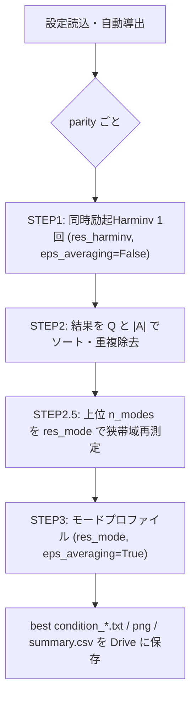

# 仕様書A: Meep版のColab高速化（A1: TPUホストのマルチコアMPI ＋ A2: アルゴリズム削減）

## 1. 目的・範囲
- `spv/run_sim.py` 一式を **Google Colab（TPU v6e-1 / v5e-1 ランタイムのホストCPU）** 上で、Meep の MPI 並列で高速に実行する。
- 対象構造は **すべて**：`structure_type` 3（ディスク）、4（リング／円形近似）、5（ディスク＋導波路）、6（ボウタイ・ツイスト格子）。
- 対象のz対称は **偶（`pz=+1`）と奇（`pz=-1`）の両方**。
- 物理モデルは現行のまま（Meep FDTD ＋ 内蔵Harminv）。結果は現行版と比較できること。

## 2. 実行環境
| 項目 | 仕様 |
|---|---|
| ランタイム | TPU v6e-1（第1候補）、v5e-1、CPU（ハイメモリ）はフォールバック用。TPUチップ自体は使わない |
| 導入方法 | `condacolab` → `mamba install -c conda-forge pymeep=*=mpi_mpich_* h5py pandas matplotlib` |
| 並列化 | `mpirun --allow-run-as-root -np $NP python run_sim.py`。`NP` は `nproc` の値から自動で決める（物理コア数に合わせ、HTは除く） |
| スレッド | 現行どおり `OMP_NUM_THREADS=1` など |
| 保存先 | Google Drive をマウントし、`OUT_DIR` へ出力する（ランタイムが切れても結果を残すため） |

起動時に `nproc`、メモリ容量、Meepのバージョンをログへ出力する。

## 3. 構成
```
spv_colab/
  colab_setup.ipynb      # 環境構築・Driveマウント・実行・結果表示
  config.py              # ユーザー入力（§4）と自動導出（§5）
  run_sim.py             # パイプライン（STEP 1 → 2 → 2.5 → 3）
  my_geometry.py         # 既存のまま（変更しない）
  my_mp_setup.py         # 多点同時励起・減衰停止を追加
  my_calculation_setup.py
  my_analysis.py         # 同時励起に合わせて簡略化
```

## 4. ユーザー入力パラメータ
```python
cfg = dict(
    structure_type = 6,
    structure = dict(            # 構造ごとに必要なキーだけを書く
        # type 6: n, a, r_ratio, slab_ratio, N_ring, twist_deg, core_r_ratio, gap_ratio, bowtie_angle
        # type 3-5: n, period, Disk_R, w, Disk_t, Sac_t, Sac_D, Out_D, Gap, Wg_w, Wg_t, Cir_reso, Dev_rate
    ),
    f_range   = (0.55, 0.75),     # 探索帯域（Meep単位 a/λ）
    parities  = ['+', '-'],       # 計算するz対称（偶/奇）
    accuracy  = dict(coarse=2, fine=4),  # 「最小特徴寸法あたりの格子数」（粗探索/本計算）
    n_modes   = 2,                # 本計算で扱う最大モード数
    run_mode  = 'ALL',            # ALL / HARMINV / MODE（既存ログの再利用）
)
```

## 5. 自動で導出するパラメータ
| パラメータ | 導出規則 |
|---|---|
| 最小特徴寸法 `d_min` | type 6: `gap_ratio*a`。type 5: `min(Gap, Wg_w, Wg_t, Disk_t)`。type 3/4: `min(w, Disk_t)`（構造関数 `min_feature(cfg)` で一か所にまとめる） |
| `res_harminv`, `res_mode` | `ceil(accuracy[k] / (d_min/period))`。下限は「材料内波長あたり12格子」：`12*n*f_max`。上限 `RES_MAX=120` を超えたら警告を出す |
| `fcen`, `df` | `fcen=(f_min+f_max)/2`、`df=1.2*(f_max-f_min)` |
| `cutoff` | 5.0 に固定 |
| `dist_to_pml` | `0.5/f_min`（波長の半分、period単位）。z方向は `max(0.5/f_min, 現行値)` |
| `pml_w` | `max(0.5/f_min, 現行値)` |
| セル `sp` | 構造寸法 ＋ `dist_to_pml` から計算（現行の式を構造ごとに関数化する） |
| 対称性 | type 6: xy方向は対称なし、zは `parities` で指定。type 3〜5: 現行の `px/py` 指定ロジックを維持する |
| 監視成分 | 偶: `ex, ey, hz`。奇: `hx, hy, ez`（z=0面で非ゼロになる成分） |
| 波源 | 監視成分と同じ3成分を、ギャップ（構造の中心）と、そこから `0.05a` ずらした点の2か所に **同時に** 置く。位相は乱数（seedを固定） |
| 監視点 | 現行の `m_pos_harminv` を構造ごとの既定値として残す |
| 計算終了 | `stop_when_fields_decayed(dt=50, c=監視成分, pt=監視点[0], decay_by=1e-5)` ＋ 上限時間 `T_MAX`（粗探索 2000、補正・本計算は `5*Q_est/f`） |
| `df_refine` | `clip(10*f/Q_coarse, 0.01, 0.06)` |
| `df_mode` | `clip(2*f/Q_refine, 0.005, 0.025)` |
| 解析閾値 | `Ath=1e-5`、`Q>20`、一致の許容幅 `0.6*df_refine`（内部定数） |

## 6. パイプライン


### A2（アルゴリズム削減）の内容
1. **同時励起**：現行の「波源2位置 × 3成分 ＝ 6回」を **1回** にまとめる（一つの `sources` リストに6個の波源を入れる）。
2. **減衰で停止**：固定の `tmax` をやめ、高Qモードには長く、低Qモードには短く計算する。
3. **STEP 2の簡略化**：ヒストグラムによる多数決をやめる。全監視点の結果を周波数の近さ（`|Δf|<f/(2Q)`）でまとめ、Qの中央値と |A| の最大値で順位付けする。出力の `best condition` ファイルの列（`freq, Q, |A|, excon, detcon, sym, file name`）は維持する。
4. **STEP 2.5 / STEP 3 の統合（オプション）**：補正実行で同時に DFT 場（`add_dft_fields`、補正後の周波数）を取り、Qが十分高ければ STEP 3 を省略する。フラグ `MERGE_REFINE_MODE=True`。
5. **ジオメトリのキャッシュ**：同じ構造・同じ解像度なら `check_epsilon` を省略する（現行の仕組みを維持）。

## 7. 出力
- `best condition {date}.txt`（現行と同じ形式）、`{date}_coarse.txt`
- `summary.csv`：parity, freq, Q, res, 実行時間
- モードプロファイルの png（現行と同じ）
- `run_log.txt`：`ProgressEstimator` による残り時間の表示を維持（work の見積もりは `res^4 × T_MAX` に変更）

## 8. 検証
| 項目 | 合格基準 |
|---|---|
| 現行版（Z840、6回実行）との比較 | 主要モードの周波数差 `< 1e-3`、Qの相対差 `< 10%` |
| 偶/奇の両方 | 各 parity で1モード以上検出される（既知の構造で確認） |
| 並列効率 | `NP=1, 2, 4, ..., nproc` でスケーリングを測り、ログに残す |
| 全構造 | type 3〜6 をそれぞれ draft 設定（`accuracy coarse=1.5`）で最後まで実行できる |

## 9. リスク
- TPUホストのvCPU数はランタイムの世代によって変わる → 起動時に計測し、少なければCPUハイメモリ版と比べて選ぶ。
- 同時励起では、ある波源が特定のモードを打ち消すことがある → 位相を乱数にする。必要なら seed を変えて2回実行する（`n_shots`、既定値は1）。
- Colabのセッション切れ → STEPごとに Drive へ書き出し、`run_mode='MODE'` で再開できるようにする。
