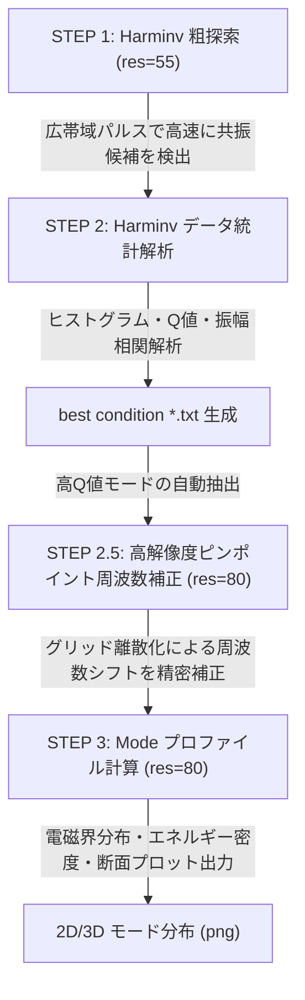

# 電磁界シミュレーションコード (`simulation/`)

本ディレクトリには、**モアレフォトニック結晶共振器（ツイスト格子）** および **誘電体ボウタイ・ナノアンテナ** を統合した極微小モード体積ナノ共振器をはじめとする電磁界FDTDシミュレーション一連のコード群が格納されています。

---

## 1. ファイル構成と役割

| ファイル名 | 役割 | 概要 |
| :--- | :--- | :--- |
| `run_sim.py` | **メイン実行スクリプト** | シミュレーションのパイプライン実行制御（粗探索 ➔ 解析 ➔ 高解像度補正 ➔ モード計算）、進捗・残り時間推定 (`ProgressEstimator`) |
| `my_geometry.py` | **構造生成モジュール** | `singular_bowtie_phc`（ツイスト格子＋ボウタイ）、2Dフォトニック結晶、マイクロディスク等の幾何構造オブジェクト生成 |
| `my_mp_setup.py` | **Meepセットアップモジュール** | 計算セルサイズ、PML境界、対称性条件、FDTD実行（Harminv, Mode計算, 周波数ソルバー, 断面スライス取得等）の管理 |
| `my_calculation_setup.py` | **計算制御モジュール** | ログ出力（ファイル/標準出力デュアルストリーム `_DualOutput`）、シミュレーションパラメータ引き渡し、実行シーケンス制御 |
| `my_analysis.py` | **解析・最適化モジュール** | Harminv出力結果の統計解析、共振周波数・Q値ヒストグラム、励起条件と検出条件の相関解析（`best condition` の抽出） |

---

## 2. 解析・最適化パイプライン (4段階ワークフロー)

本シミュレーション環境では、計算リソースと時間を極限まで最適化するため、**2段階解像度アプローチ (手法B)** を採用しています。



1. **STEP 1: Harminv 粗探索 (`res=55`)**
   - 低めの解像度と広帯域ガウシアン波源（$df = 0.20$）を用いて、対象帯域内の共振モード候補を一括探索。
   - `pz_fixed = 1`（偶対称条件）により監視成分を `ex`, `ey`, `hz` に絞り込み、I/Oと計算負荷を半減。
2. **STEP 2: データ統計解析**
   - 複数位置・複数偏光での検出データを集約し、ヒストグラムおよびメディアンフィルタリングにより高Q値・高励起効率の最適共振条件（`best condition`）を同定。
3. **STEP 2.5: 高解像度ピンポイント周波数補正 (`res=80`)**
   - 解像度引き上げに伴う共振周波数のわずかなシフトを補正するため、狭帯域パルス（$df = 0.06$）でピンポイントに周波数を高精度再測定。
4. **STEP 3: Mode プロファイル計算 (`res=80`)**
   - 補正された正確な共振周波数でCWまたは狭帯域波源を励起し、電磁界分布（$E_x, E_y, H_z$）および電磁エネルギー密度分布（$D_{\text{den}}, H_{\text{den}}$）を画像出力。

---

## 3. 実行方法

環境: `pmp.md` 記載の Conda環境 `pmp` (Linux / WSL, HP Z840 Workstation: 20コア/40スレッド)

### MPI並列実行（推奨）
```bash
# pmp 環境のアクティベート
conda activate pmp

# 作業ディレクトリへ移動
cd /path/to/gemini-workspace/simulation

# 20プロセス並列での実行例
mpirun -np 20 python run_sim.py
```

### 実行モード (`RUN_MODE`) の切り替え
`run_sim.py` 冒頭の `RUN_MODE` 変数により、個別実行やバッチ実行を柔軟に制御できます。

- `'ALL'`: 全自動実行（① ➔ ② ➔ ②.5 ➔ ③）
- `'HARMINV_BOTH'`: 粗探索と解析のみ実行（① ➔ ②）
- `'HARMINV_SIM'`: Harminv計算のみ実行（①）
- `'HARMINV_ANA'`: 既存ログに対する解析のみ実行（②）
- `'MODE_SIM'`: 抽出済み条件に基づく高解像度補正とモード計算のみ実行（②.5 ➔ ③）

---

## 4. 主な構造・材料パラメータ（ボウタイ型モアレ共振器）

- **格子周期 ($a$)**: $0.45\ \mu\text{m}$ ($450\ \text{nm}$)
- **スラブ屈折率 ($n$)**: $3.4$ (InGaAsP / 半導体多重量子井戸)
- **スラブ厚比**: $0.50$ ($t = 225\ \text{nm}$)
- **空気孔半径比 ($r/a$)**: $0.26$
- **ツイスト角 ($\theta$)**: $3.5^\circ \sim 3.89^\circ$
- **ボウタイ外径比**: $0.55$
- **ボウタイ頂角**: $60.0^\circ$
- **中心ギャップ比 ($g/a$)**: $0.02 \sim 0.01$ (実寸法 $4.5 \sim 9\ \text{nm}$、ALD被覆により1nm領域まで微細化可能)

